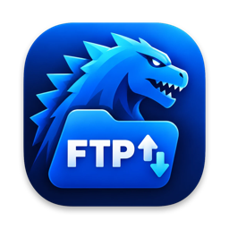
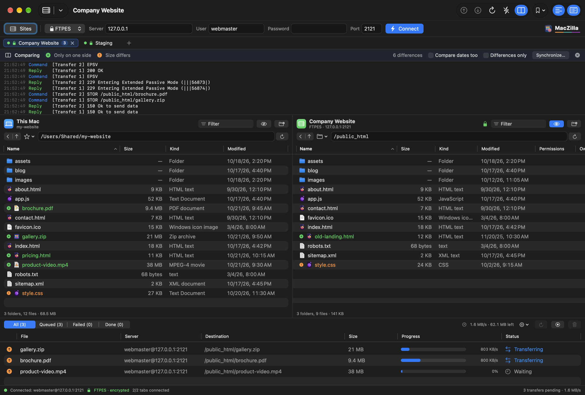
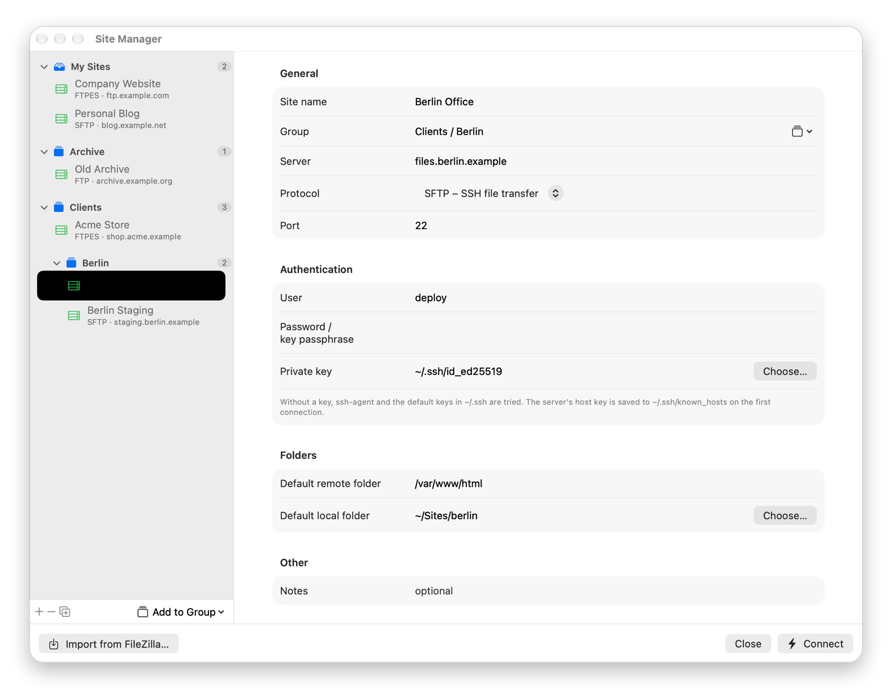
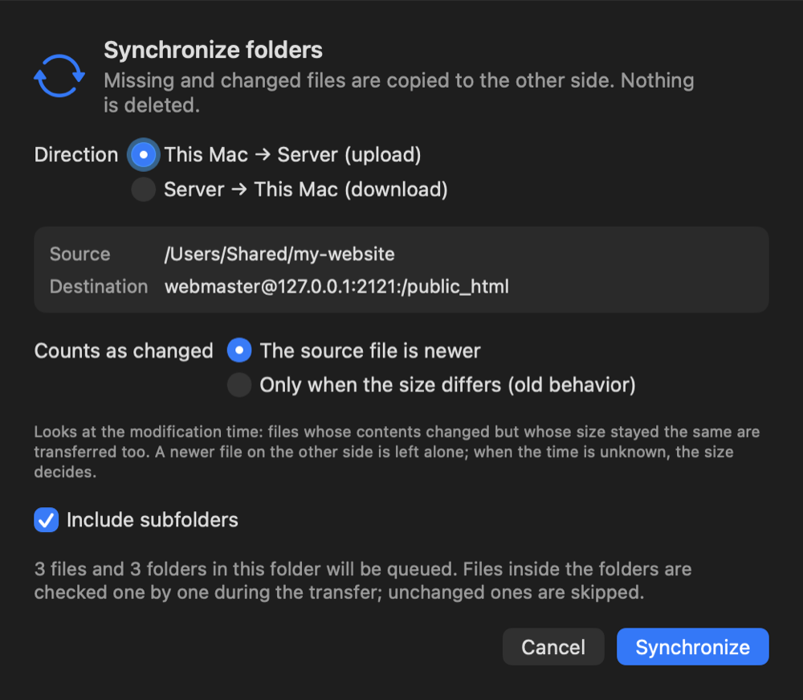
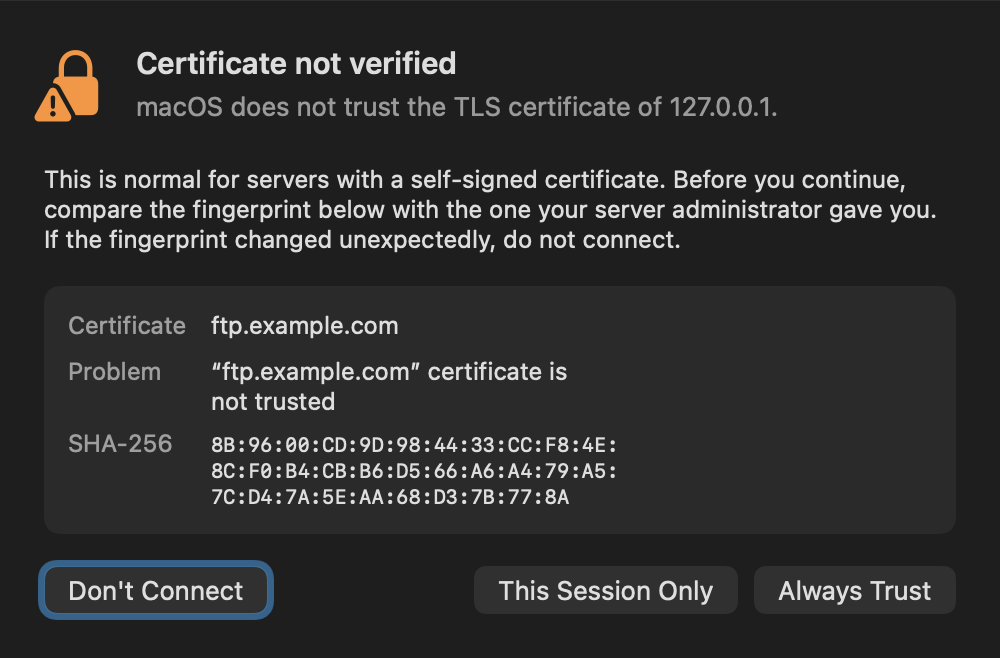
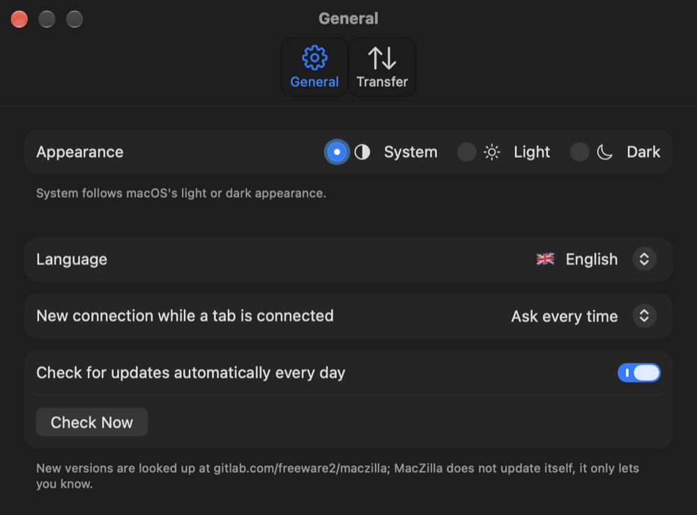
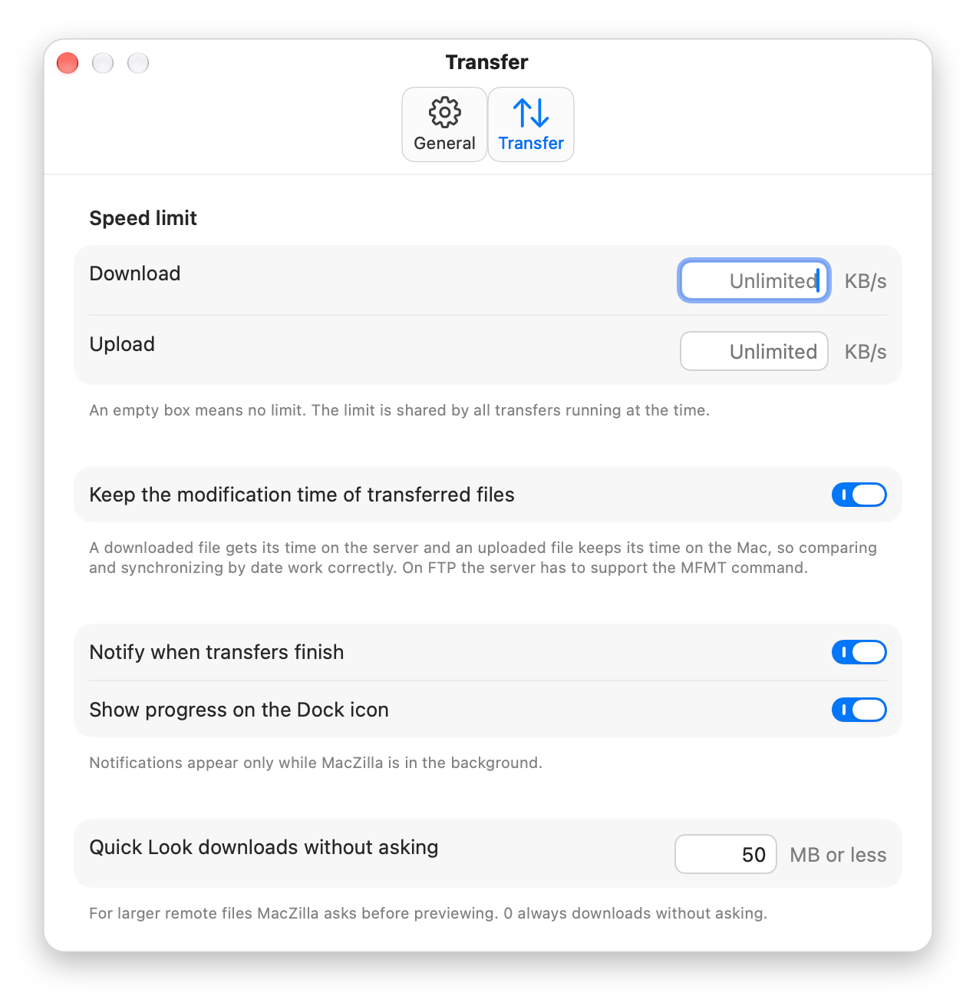

<p align="center">
  
</p>

<h1 align="center">MacZilla</h1>

<p align="center">
  A free, open-source, native (SwiftUI) <b>FTP, FTPS and SFTP</b> client for macOS, in the spirit of FileZilla.<br>
  Written entirely in Swift; no Electron and no third-party libraries.
</p>

<p align="center">
  A free, native alternative to <b>FileZilla</b>, <b>Cyberduck</b> and <b>Transmit</b> on the Mac.
</p>

<p align="center">
  <b>🇬🇧 English</b> · <a href="README.tr.md">🇹🇷 Türkçe</a>
</p>

<p align="center">
  <a href="https://gitlab.com/freeware2/maczilla/-/releases/permalink/latest/downloads/MacZilla.zip"></a>
</p>

<p align="center">
  <a href="https://gitlab.com/freeware2/maczilla/-/releases">All releases</a> · <a href="#download-and-install">Installation steps</a> · The interface is in English and Turkish
</p>

> [!warning] The first time you open MacZilla, macOS blocks it. This is expected.
> MacZilla is free and not notarized by Apple, so the first time you open it macOS says it *could not verify* the app and does not open it. You only need to allow it once:
>
> 1. In the warning, click **Done**. Do **not** click *Move to Trash*.
> 2. Open **System Settings ▸ Privacy & Security** and scroll down to **Security**.
> 3. On the line saying MacZilla was blocked, click **Open Anyway** and confirm with your password or Touch ID.
>
> Prefer Terminal? Run `xattr -dr com.apple.quarantine /Applications/MacZilla.app`, then open MacZilla.
>
> Step by step, and what to do if *Open Anyway* is missing: **[First launch](#first-launch-allow-maczilla-once)**.

## Screenshots

### ⭐ Two panes, tabs and a live transfer queue

This Mac on the left, the server on the right. Every tab is its own connection with its own server log. Here folder comparison is on (green: only on one side, orange: size differs) and three uploads are running over FTPES.

<p align="center"></p>

### Site Manager

Sites in groups that you can nest and fill by drag and drop, in a window you can resize. Passwords stay in the macOS Keychain.

<p align="center"></p>

### Synchronize folders

Missing and changed files are copied to the other side; nothing is deleted. Changes are found by modification time, so edits that keep the size the same are caught too.

<p align="center"></p>

### Certificate check

When macOS does not trust a server's certificate, MacZilla shows its SHA-256 fingerprint before connecting. Trusting it takes an explicit click.

<p align="center"></p>

### Settings

Appearance, language, what happens when you connect while a tab is connected, and update checks. On the Transfer tab: speed limits (an empty box means no limit), file times, notifications and Quick Look.

<p align="center">
  
  &nbsp;
  
</p>

<p align="center"><sub>Screenshots from the English interface. MacZilla follows the system language; you can switch it to Turkish in Settings.</sub></p>

## Features

**Interface**
- Two panes: this Mac on the left, the server on the right. Sortable columns, filtering, hidden files, back / up
- **Tabs:** each tab is a separate connection, so you can work with several servers at once (⌘T). The **+** button sits right after the last tab, as in web browsers
- Drag and drop between the panes and from the Finder to the server pane
- Colored server log (status, command, response, error); **each tab has its own log**, so lines from different servers never mix
- A lock icon in the status bar and the server pane shows whether the connection is encrypted
- Light, dark or system appearance; English and Turkish interface

**Transfers**
- Concurrent transfer queue (1–6); folders are transferred with their contents
- Progress and speed per file; stop, retry, remove from queue
- Every transfer belongs to the server it started on: a retry goes to the right server even if the tab has switched
- "File already exists" rule: overwrite, skip, overwrite if the size differs, or overwrite if the source is newer
- Download and upload speed limits (shared by all running transfers)
- Progress bar and remaining count on the Dock icon; a notification when transfers finish while MacZilla is in the background

**Server operations**
- New folder, rename, delete (folders with their contents), permissions (CHMOD)
- **Edit:** a remote file opens in an editor on your Mac and is uploaded every time you save it
- Quick Look (Space or ⌘Y) for local and remote files
- **Folder comparison and synchronizing:** differences between the panes are colored; missing or changed files are copied to the other side with one click (nothing is deleted). Changes are detected by modification time, so edits that keep the size the same are transferred too
- **Keeps file times:** a downloaded file gets its time on the server, an uploaded file keeps its time on the Mac (MFMT on FTP, file attributes on SFTP)
- Open / view remote files, copy their URL
- Automatic reconnect when the connection drops, keep-alive

## Protocols

| Protocol | Description | Default port |
|---|---|---|
| FTP | Unencrypted; passwords and files travel as plain text | 21 |
| FTPES | Explicit TLS (`AUTH TLS`); data connections are encrypted too | 21 |
| FTPS | Implicit TLS; the connection is encrypted from the first byte | 990 |
| SFTP | SSH file transfer through macOS's own `ssh` tool | 22 |

- FTP uses passive mode (EPSV, PASV if needed); local addresses reported by servers behind NAT are corrected. Listings are read with MLSD, or from Unix or Windows/DOS style LIST output when MLSD is not supported. UTF-8 file names are supported.
- SFTP runs on the system's `/usr/bin/ssh`: the SSH keys, ssh-agent, `~/.ssh/config` and `known_hosts` you use in Terminal apply as they are. The server key is saved on the first connection; if it changes later, the connection is refused.
- TLS connections are made with macOS SecureTransport (up to TLS 1.2).

### Certificate trust

When MacZilla meets a certificate macOS does not trust (a self-signed one, for example), it asks before connecting. The certificate's SHA-256 fingerprint is shown; you can choose "Only This Session" or "Always Trust". Trusting takes an explicit click: Return confirms nothing, and Esc or closing the window in any other way counts as "Don't Connect".

## Site Manager

Save the servers you use often with their protocol, user, SSH key and default folders (⌘S). Passwords are kept in the macOS Keychain; the site list is in `~/Library/Application Support/MacZilla/sites.json`. Recently used sites can also be opened from the menu in the quick connect bar.

The Site Manager opens in its own window, which you can resize.

- **Groups:** collect sites in groups such as "Clients". Use the *Add to Group* button below the list, or right-click a site.
  - **Drag and drop:** select one or more sites (⌘-click or ⇧-click) and drag them onto a group's header. Drop them on *My Sites* to take them out of their group.
  - **Groups inside groups:** write the names separated by a slash, such as `Clients/Berlin` or `Clients / Berlin`, or right-click a group's header and choose *New Subgroup…*.
  - **Rename a group:** right-click its header and choose *Rename Group…*. The groups inside it are renamed along with it.
- **Save to Sites:** turn the server you reached with a quick connection into a site in one step with File › Save to Sites….
- **Bookmarks (⌘B):** save pairs of local and remote folders you use often for a connection; the Bookmarks menu takes both panes there at once. Bookmarks belong to the server (the site, or the address of a quick connection), not to a tab.
- **Import from FileZilla:** the *Import from FileZilla…* button in the Site Manager reads FileZilla's `~/.config/filezilla/sitemanager.xml` (or a file saved with File › Export). Sites, folders (as groups), bookmarks and passwords are imported. Passwords protected by FileZilla's master password cannot be imported; enter them again for those sites.

The quick connect bar also takes an address directly: `sftp://user@server:2222`, `ftpes://server/public_html` and so on.

### Tabs and connections

Every tab has its own connection, local and remote panes, and server log. The transfer queue is shared, and the queue shows which server each transfer belongs to. If you connect to a new server while the tab is connected, MacZilla asks whether to open a new tab or replace the connection in this tab; you can make the choice permanent in Settings. Closing a connection or tab that still has transfers running asks first.

## Comparing and synchronizing

View › Compare Folders (⌥⌘C) colors the differences between the two panes: items on one side only, items with a different size and (with "Compare dates too" on) newer or older items. Synchronize… copies the differences to the other side with one click; no file is ever deleted.

The Synchronize window has two rules:

- **If the source file is newer** (default): files missing on the other side and files whose modification time is newer than the other side's are transferred. If the other side's file is newer it is left alone; when the time cannot be found, the size decides.
- **Only if the size differs:** the old behavior; it misses changes that keep the size the same.

Times come exact to the second with MLSD or SFTP. On FTP servers that only support LIST, the time in the listing is to the minute and in the server's time zone; MacZilla then asks for each file's exact time with MDTM before transferring it. The colors in the comparison bar use the listing times, so on such servers the "newer/older" marks can be off by the time zone difference; the synchronize decision is not.

## Settings

In MacZilla › Settings… (⌘,):

- **Appearance:** System, Light or Dark (also in View › Appearance)
- **Language:** system language, Türkçe or English, each with its flag. It takes effect when MacZilla restarts; the note and the *Restart Now* button appear in the language you picked, so you can find them even if you cannot read the current one
- **New connection while connected:** ask every time, open in a new tab, or replace the one in this tab
- **Updates:** checks GitLab for new versions once a day; MacZilla does not update itself, it only lets you know
- **Transfer:** keep the time of transferred files, download and upload speed limits in KB/s (an empty box means no limit), notifications, progress on the Dock, the largest file Quick Look downloads without asking

## Download and install

The package runs on Apple Silicon and Intel Macs; macOS 14 or later is required.

1. Download the latest version with the [download button](https://gitlab.com/freeware2/maczilla/-/releases/permalink/latest/downloads/MacZilla.zip) at the top, or pick a version on the [Releases](https://gitlab.com/freeware2/maczilla/-/releases) page.
2. Open the zip. Safari usually opens it by itself and a `MacZilla-<version>` folder appears in Downloads; if not, double-click the zip.
3. Drag `MacZilla.app` from that folder to **Applications**. The `LICENSE.txt` next to it is the license text; it does not need to be installed.
4. Open MacZilla. **The first time, macOS blocks it:** follow the steps below once.

### First launch: allow MacZilla once

> [!important] macOS blocks MacZilla the first time you open it. This is expected, not a fault.
> MacZilla is not signed with an Apple developer ID and is not notarized by Apple, so macOS cannot verify it. Allow it once and it opens normally from then on:
>
> 1. **Double-click MacZilla.** macOS says Apple could not verify it and does not open it. Click **Done**. Do **not** click *Move to Trash*.
> 2. **Open System Settings ▸ Privacy & Security** and scroll down to the **Security** section.
> 3. **Click Open Anyway** on the line saying MacZilla was blocked, then confirm with your Mac password or Touch ID. If macOS asks once more, choose **Open Anyway** again.
>
> Don't see *Open Anyway*? Repeat step 1: the button only appears after an attempt to open the app. On macOS 14 you can also right-click MacZilla in the Finder and choose **Open**.

> [!tip] Using Terminal? One command does the same.
> ```bash
> xattr -dr com.apple.quarantine /Applications/MacZilla.app
> ```
> It removes the quarantine flag macOS puts on files downloaded from the internet. MacZilla then opens with a double-click as usual.

### Verifying the download

Compare the zip with the SHA-256 value in the release notes:

```bash
shasum -a 256 ~/Downloads/MacZilla-1.3.2.zip
```

## Building from source

Requires Xcode 15.3 or later and macOS 14 or later.

```bash
git clone https://gitlab.com/freeware2/maczilla.git
cd maczilla
./build-app.sh            # makes build/MacZilla.app (universal: Apple Silicon + Intel)
./build-app.sh --install  # copies it to /Applications
./build-app.sh --zip      # build/release/MacZilla-<version>.zip and its SHA-256 file
```

## Shortcuts

| Shortcut | Action |
|---|---|
| ⌘T / ⌘W | New tab / close tab |
| ⇧⌘] / ⇧⌘[ | Next / previous tab |
| ⌘S | Site Manager |
| ⌘B | Add bookmark |
| ⌘Y / Space | Quick Look |
| ⌥⌘C | Compare folders |
| ⌘, | Settings |
| ⌘R | Refresh both panes |
| ⌘D | Disconnect |
| ⇧⌘R | Reconnect |
| ⌥⌘↑ / ⌥⌘↓ | Upload / download the selection |
| ⌥⌘L / ⌥⌘Q | Show/hide the log / the queue |
| Double-click | Enter a folder; transfer a file |
| ⌫ | Delete the selection (asks first) |

## Project layout

```
Sources/
  FTPKit/      Protocol layer: FTP/FTPS (socket + TLS), SFTP (over ssh), listing parsers
  MacZilla/    SwiftUI app: tabs, panes, transfer queue, Site Manager, Settings
  ftpcheck/    Command-line test tool for the protocol layer
Scripts/       App icon script (cuts the icon out of Resources/IconArtwork.png), translation check
Resources/     Info.plist, icon, translations (tr.lproj, en.lproj)
```

### Translations

Interface strings are written in Turkish in the source code and double as translation keys. The English texts are in `Resources/en.lproj/Localizable.strings`, singular/plural forms in `Localizable.stringsdict`. When you add a string, check that both languages have it:

```bash
./Scripts/check-strings.sh
```

## Testing

The `ftpcheck` tool exercises the protocol layer against a real server (upload, download, listing, rename, concurrent requests, folder delete):

```bash
swift run ftpcheck ftp 127.0.0.1 21 user password
```

The protocol can be `ftp`, `ftpes`, `ftps` or `sftp`. For SFTP a key file and extra `ssh` options can be given too:

```bash
swift run ftpcheck sftp server.example.com 22 user "" ~/.ssh/id_ed25519
```

## FAQ

### Is MacZilla free?

Yes. MacZilla is free and open source under the GPL-3.0 license, with no ads, no accounts and no in-app purchases.

### Is there a native FileZilla for Mac?

FileZilla itself runs on the Mac, but it is not a native Mac app. MacZilla is written in Swift and SwiftUI with the same idea: two panes, tabs, a transfer queue and a Site Manager. It can import your FileZilla sites, folders, bookmarks and passwords.

### Can I connect with SFTP using my SSH key?

Yes. SFTP runs through macOS's own `ssh`, so your SSH keys, ssh-agent, `~/.ssh/config` and `known_hosts` work exactly as in Terminal.

### Does it support FTPS (FTP over TLS)?

Yes, both explicit (FTPES) and implicit (FTPS) TLS. A certificate macOS does not trust is shown with its SHA-256 fingerprint and connects only after you allow it.

### Where are my passwords stored?

In the macOS Keychain. The site list itself is a JSON file in `~/Library/Application Support/MacZilla`.

### Which Macs does it run on?

Apple Silicon and Intel Macs with macOS 14 Sonoma or later.

### Why does macOS block it the first time?

MacZilla is not notarized by Apple, which needs a paid developer account. Allow it once in **System Settings ▸ Privacy & Security ▸ Open Anyway**; see [First launch](#first-launch-allow-maczilla-once).

<sub>FileZilla, Cyberduck and Transmit are named only for comparison; MacZilla is not affiliated with them.</sub>

## License

Copyright © 2026 Rafet SAPANCI

MacZilla is free software: you can use, change and redistribute it under the [GNU General Public License](LICENSE), version 3 or (at your option) any later version (GPL-3.0-or-later). If you distribute changed versions, you must offer their source code under the same license. The program comes with **no warranty**; see [LICENSE](LICENSE) for details.

MacZilla is not affiliated with the FileZilla project. SFTP connections are made through the OpenSSH client that comes with macOS.
