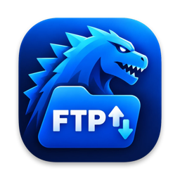
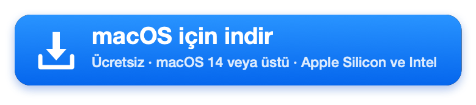
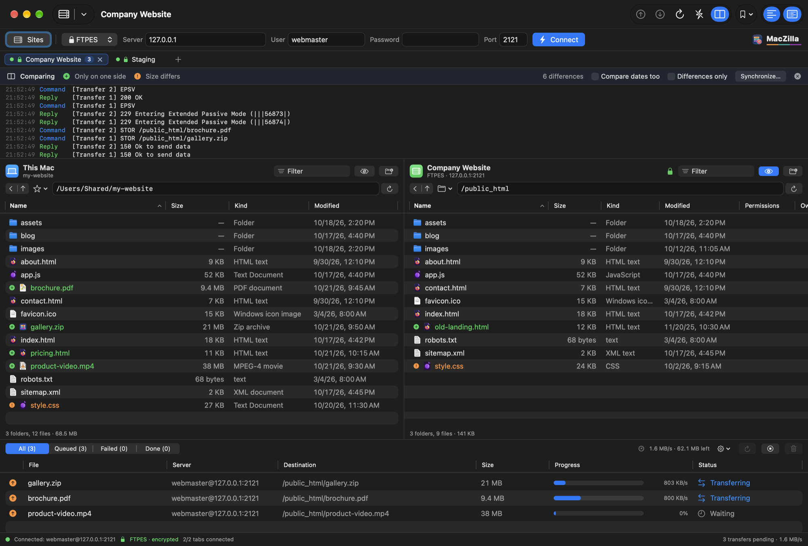
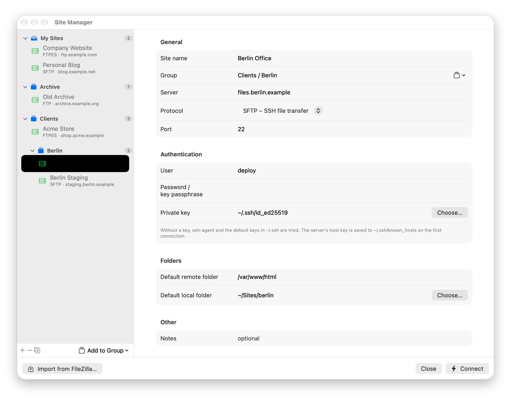
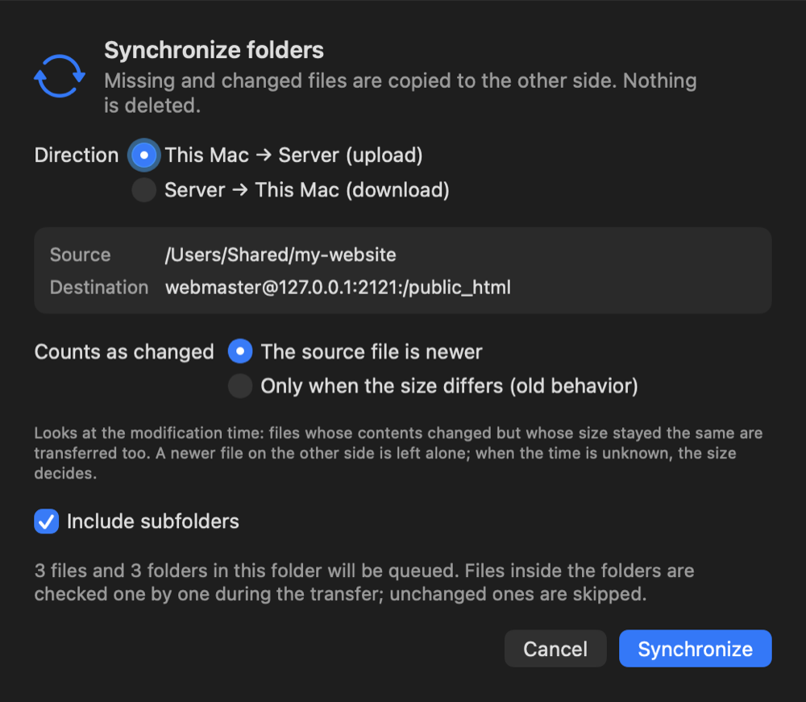
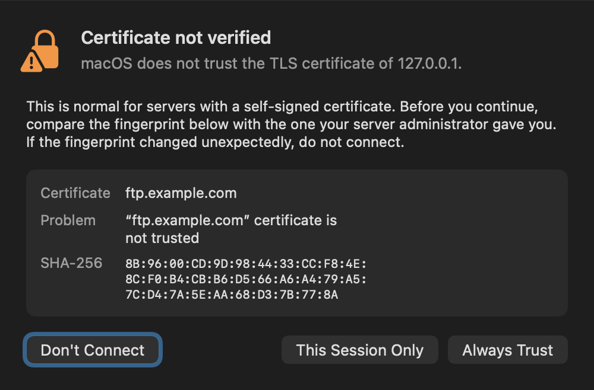
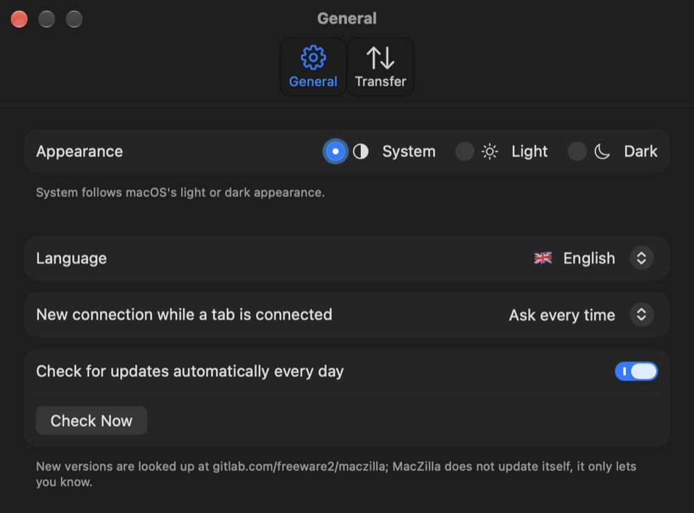
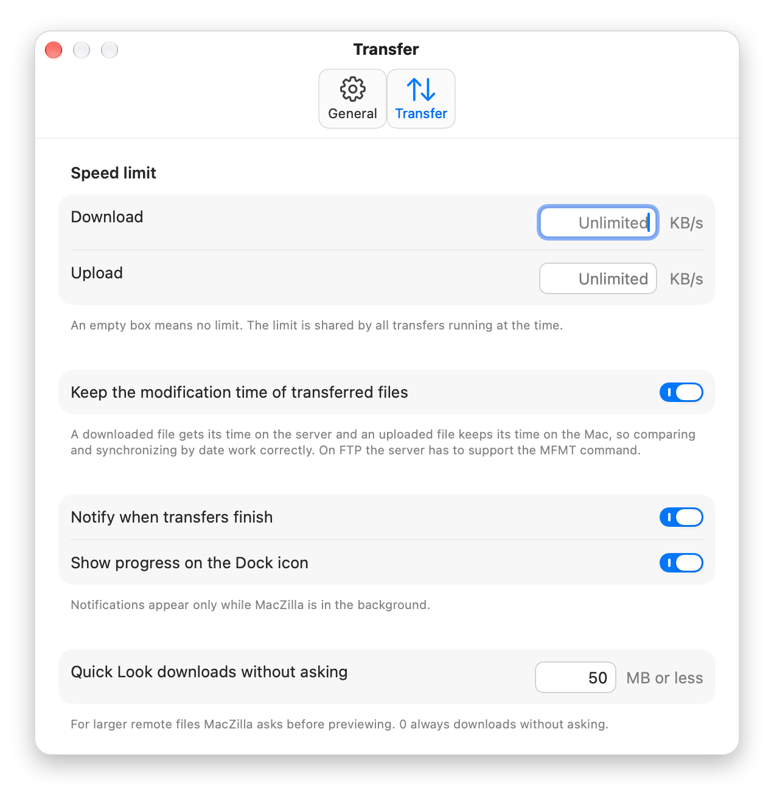

<p align="center">
  
</p>

<h1 align="center">MacZilla</h1>

<p align="center">
  macOS için FileZilla tarzı, yerel (SwiftUI) bir <b>FTP, FTPS ve SFTP</b> istemcisi.<br>
  Tamamen Swift ile yazılmıştır; Electron ya da üçüncü taraf kütüphane gerektirmez.
</p>

<p align="center">
  <a href="README.md">🇬🇧 English</a> · <b>🇹🇷 Türkçe</b>
</p>

<p align="center">
  <a href="https://gitlab.com/freeware2/maczilla/-/releases/permalink/latest/downloads/MacZilla.zip"></a>
</p>

<p align="center">
  <a href="https://gitlab.com/freeware2/maczilla/-/releases">Tüm sürümler</a> · <a href="#kurulum">Kurulum adımları</a> · Arayüz Türkçe ve İngilizcedir
</p>

> [!warning] MacZilla'yı ilk açtığınızda macOS onu engeller. Bu beklenen bir durumdur.
> MacZilla ücretsizdir ve Apple onayından (notarization) geçmemiştir. Bu yüzden ilk açılışta macOS uygulamayı *doğrulayamadığını* söyler ve açmaz. Bunu bir kez onaylamanız yeterlidir:
>
> 1. Uyarıda **Bitti**'ye tıklayın. *Çöp Sepetine Taşı*'yı **seçmeyin**.
> 2. **Sistem Ayarları ▸ Gizlilik ve Güvenlik**'i açın ve **Güvenlik** bölümüne inin.
> 3. MacZilla'nın engellendiğini belirten satırda **Yine de Aç**'a tıklayın ve parolanız ya da Touch ID ile onaylayın.
>
> Terminal'i mi tercih edersiniz? `xattr -dr com.apple.quarantine /Applications/MacZilla.app` komutunu çalıştırıp MacZilla'yı açın.
>
> Adım adım anlatım ve *Yine de Aç* görünmezse ne yapacağınız: **[İlk açılış](#maczillayı-ilk-açış-bir-kez-izin-verin)**.

## Ekran görüntüleri

### ⭐ İki panel, sekmeler ve canlı aktarım kuyruğu

Solda bu Mac, sağda sunucu. Her sekme kendi bağlantısı ve kendi sunucu günlüğüyle çalışır. Burada klasör karşılaştırması açık (yeşil: yalnızca bir tarafta, turuncu: boyutu farklı) ve FTPES üzerinden üç yükleme sürüyor.

<p align="center"></p>

### Site Yöneticisi

İç içe olabilen ve sürükle-bırakla doldurulan gruplar, boyutu değiştirilebilen bir pencerede. Şifreler macOS Anahtar Zinciri'nde kalır.

<p align="center"></p>

### Klasörleri eşitleme

Eksik ve değişmiş dosyalar karşı tarafa kopyalanır; hiçbir şey silinmez. Değişiklik değiştirilme tarihine göre anlaşıldığı için boyutu aynı kalan düzenlemeler de yakalanır.

<p align="center"></p>

### Sertifika denetimi

macOS bir sunucunun sertifikasına güvenmediğinde MacZilla bağlanmadan önce sertifikanın SHA-256 parmak izini gösterir. Güvenmek için açıkça tıklamak gerekir.

<p align="center"></p>

### Ayarlar

Görünüm, dil, bir sekme bağlıyken yeni bağlantıda ne olacağı ve güncelleme denetimi. Aktarım sekmesinde: hız sınırları (kutu boşsa sınır yok), dosya tarihleri, bildirimler ve Hızlı Bakış.

<p align="center">
  
  &nbsp;
  
</p>

<p align="center"><sub>Görüntüler İngilizce arayüzden alınmıştır. MacZilla sistem dilini izler; Ayarlar'dan Türkçeye geçebilirsiniz.</sub></p>

## Özellikler

**Arayüz**
- İki panel: solda bu Mac, sağda uzak sunucu. Sıralanabilir sütunlar, süzme, gizli dosyalar, geri / üst klasör
- **Sekmeler:** her sekme ayrı bir bağlantı; aynı anda birden fazla sunucuyla çalışın (⌘T). **+** düğmesi, tarayıcılardaki gibi son sekmenin hemen sağındadır
- Sürükle-bırak: paneller arasında ve Finder'dan uzak panele
- Renkli sunucu günlüğü (durum, komut, yanıt, hata); **her sekmenin kendi günlüğü vardır**, farklı sunucuların satırları birbirine karışmaz
- Durum çubuğunda ve uzak panelde bağlantının şifreli olup olmadığı kilit simgesiyle gösterilir
- Açık, koyu ya da sistemle aynı görünüm; Türkçe ve İngilizce arayüz

**Aktarım**
- Eşzamanlı aktarım kuyruğu (1–6), klasörleri içerikleriyle birlikte aktarma
- Dosya başına ilerleme ve hız; durdurma, yeniden deneme, kuyruktan kaldırma
- Her aktarım başladığı sunucuya bağlıdır: sekme başka sunucuya geçse de yeniden deneme doğru sunucuya gider
- "Dosya zaten varsa" kuralı: üzerine yaz, atla, boyut farklıysa yaz ya da kaynak daha yeniyse yaz
- İndirme ve yükleme için hız sınırı (bütün aktarımlar arasında paylaştırılır)
- Dock simgesinde ilerleme çubuğu ve kalan aktarım sayısı; MacZilla arka plandayken aktarımlar bitince bildirim

**Sunucu işlemleri**
- Yeni klasör, yeniden adlandırma, silme (klasörler içerikleriyle birlikte), izinler (CHMOD)
- **Düzenle:** uzak dosya Mac'teki düzenleyicide açılır, her kaydettiğinizde sunucuya yüklenir
- Hızlı Bakış (boşluk tuşu ya da ⌘Y): yerel ve uzak dosyaları önizleme
- **Klasör karşılaştırma ve eşitleme:** iki paneldeki farklar renkle işaretlenir; eksik ya da değişmiş dosyalar tek tıkla karşı tarafa kopyalanır (hiçbir şey silinmez). Değişiklik değiştirilme tarihine göre anlaşıldığı için boyutu aynı kalan düzenlemeler de (ör. "elma" → "alma") aktarılır
- **Tarih koruma:** indirilen dosya sunucudaki, yüklenen dosya Mac'teki değiştirilme tarihini korur (FTP'de MFMT, SFTP'de dosya özellikleriyle)
- Uzak dosyayı aç / görüntüle, URL'yi kopyala
- Bağlantı koptuğunda otomatik yeniden bağlanma, keep-alive

## Protokoller

| Protokol | Açıklama | Varsayılan port |
|---|---|---|
| FTP | Şifrelenmemiş; şifre ve dosyalar açık metin gider | 21 |
| FTPES | Açık TLS (`AUTH TLS`); veri bağlantıları da şifrelenir | 21 |
| FTPS | Örtük TLS; bağlantı ilk bayttan şifreli başlar | 990 |
| SFTP | SSH dosya aktarımı, macOS'un kendi `ssh` aracı üzerinden | 22 |

- FTP tarafında pasif mod (EPSV, gerekirse PASV) kullanılır; NAT arkasındaki sunucuların bildirdiği yerel adresler düzeltilir. Listeler MLSD ile, desteklenmiyorsa Unix ya da Windows/DOS biçimindeki LIST çıktısından okunur. UTF-8 dosya adları desteklenir.
- SFTP, sistemdeki `/usr/bin/ssh` ile çalışır: Terminal'de kullandığınız SSH anahtarları, ssh-agent, `~/.ssh/config` ve `known_hosts` olduğu gibi geçerlidir. Sunucu anahtarı ilk bağlantıda kaydedilir; sonradan değişirse bağlantı reddedilir.
- TLS bağlantıları macOS SecureTransport ile kurulur (en fazla TLS 1.2).

### Sertifika onayı

macOS'un güvenmediği bir sertifikayla karşılaşıldığında (örneğin kendinden imzalı sertifikalar) MacZilla bağlanmadan önce sorar. Sertifikanın SHA-256 parmak izi gösterilir; "Yalnızca Bu Oturum" ya da "Her Zaman Güven" seçilebilir. Güvenmek için açıkça tıklamak gerekir: Return tuşu bir şey onaylamaz, Esc ve pencerenin başka biçimde kapanması "Bağlanma" sayılır.

## Site Yöneticisi

Sık bağlandığınız sunucuları protokol, kullanıcı, SSH anahtarı ve varsayılan dizinleriyle kaydedin (⌘S). Şifreler macOS Anahtar Zinciri'nde saklanır; site listesi `~/Library/Application Support/MacZilla/sites.json` dosyasındadır. Son kullanılan siteler hızlı bağlantı çubuğundaki menüden de açılabilir.

Site Yöneticisi, boyutu değiştirilebilen ayrı bir pencerede açılır.

- **Gruplar:** siteleri "Müşteriler" gibi gruplarda toplayın. Listenin altındaki *Grupla* düğmesini kullanın ya da siteye sağ tıklayın.
  - **Sürükle-bırak:** bir ya da birden fazla siteyi seçin (⌘ ya da ⇧ ile tıklayarak) ve bir grubun başlığına sürükleyin. *Sitelerim* başlığına bırakılan siteler gruptan çıkar.
  - **Grup içinde grup:** adları eğik çizgiyle ayırın, ör. `Müşteriler/Ankara` ya da `Müşteriler / Ankara`; ya da grup başlığına sağ tıklayıp *Alt Grup Oluştur…*'u seçin.
  - **Grup adını değiştirme:** grup başlığına sağ tıklayıp *Grubu Yeniden Adlandır…*'ı seçin. İçindeki alt gruplar da onunla birlikte taşınır.
- **Sitelere kaydet:** hızlı bağlantıyla bağlandığınız sunucuyu Dosya › Sitelere Kaydet… ile tek adımda siteye dönüştürün.
- **Yer imleri (⌘B):** bir bağlantı için sık kullandığınız yerel ve uzak klasör çiftlerini kaydedin; Yer İmleri menüsünden iki paneli birden oraya götürün. Yer imleri sekmeye değil, sunucuya (siteye ya da hızlı bağlantının adresine) aittir.
- **FileZilla'dan aktarma:** Site Yöneticisi'ndeki *FileZilla'dan Aktar…* düğmesi FileZilla'nın `~/.config/filezilla/sitemanager.xml` dosyasını (ya da Dosya › Dışa Aktar ile kaydedilmiş bir dosyayı) okur. Siteler, klasörler (MacZilla'da grup olarak), yer imleri ve şifreler aktarılır. FileZilla ana parolasıyla korunan şifreler aktarılamaz; bunlar için şifreyi yeniden girmeniz gerekir.

Hızlı bağlantı çubuğu protokol seçmenin yanında doğrudan adres de kabul eder: `sftp://kullanici@sunucu:2222`, `ftpes://sunucu/public_html` gibi.

### Sekmeler ve bağlantılar

Her sekmenin kendi bağlantısı, yerel ve uzak paneli ve sunucu günlüğü vardır; aktarım kuyruğu ortaktır ve her aktarımın hangi sunucuya ait olduğu kuyrukta yazar. Bir sekme bağlıyken hızlı bağlantı çubuğundan ya da Site Yöneticisi'nden yeni bir sunucuya bağlanırsanız MacZilla yeni bir sekme mi açacağını, yoksa bu sekmedeki bağlantıyı mı değiştireceğini sorar. Bu tercih Ayarlar'dan kalıcı yapılabilir. Süren aktarımları olan bir bağlantı kesilmeden ya da sekmesi kapatılmadan önce onay istenir.

## Karşılaştırma ve eşitleme

Görüntü › Klasörleri Karşılaştır (⌥⌘C) iki paneldeki farkları renkle işaretler: yalnızca bir tarafta olanlar, boyutu farklı olanlar ve ("Tarihleri de karşılaştır" açıksa) daha yeni ya da daha eski olanlar. Eşitle… farkları tek tıkla karşı tarafa kopyalar; hiçbir dosya silinmez.

Eşitle penceresinde iki kural vardır:

- **Kaynaktaki dosya daha yeniyse** (varsayılan): karşı tarafta olmayan dosyalar ve değiştirilme tarihi karşı taraftakinden yeni olan dosyalar aktarılır. Karşı taraftaki dosya daha yeniyse ona dokunulmaz; tarih öğrenilemiyorsa boyuta bakılır.
- **Yalnızca boyutu farklıysa:** eski davranış; boyutu aynı kalan değişiklikleri görmez.

Tarihler MLSD ya da SFTP ile saniyesine kadar kesin gelir. Yalnızca LIST destekleyen FTP sunucularında listedeki tarih dakika hassasiyetinde ve sunucunun saat dilimindedir; MacZilla bu durumda her dosyayı aktarmadan önce kesin tarihini MDTM komutuyla sorar. Karşılaştırma çubuğundaki renkler ise listedeki tarihleri kullanır; böyle sunucularda "daha yeni/eski" işaretleri saat dilimi farkı kadar yanılabilir, eşitleme kararı yanılmaz.

## Ayarlar

MacZilla › Ayarlar… (⌘,) penceresinde:

- **Görünüm:** Sistem, Açık ya da Koyu (Görüntü › Görünüm menüsünden de değiştirilebilir)
- **Dil:** sistem dili, Türkçe ya da English, bayraklarıyla. MacZilla yeniden açılınca geçerli olur; bilgi notu ve *Şimdi Yeniden Başlat* düğmesi seçtiğiniz dilde çıkar, böylece o anki dili bilmeyen biri de bulabilir
- **Bağlıyken yeni bağlantı:** her seferinde sor, yeni sekmede aç ya da bu sekmedekini değiştir
- **Güncellemeler:** GitLab'deki yeni sürümleri günde bir kez denetleme; MacZilla kendini güncellemez, yalnızca haber verir
- **Aktarım:** aktarılan dosyaların tarihini koruma, KB/sn cinsinden indirme ve yükleme hız sınırı (kutu boşsa sınır yoktur), bildirimler, Dock'ta ilerleme, Hızlı Bakış'ta sormadan indirilecek en büyük dosya boyutu

## Kurulum

Paket Apple Silicon ve Intel Mac'lerde çalışır; macOS 14 veya üstü gerekir.

1. En yeni sürümü en üstteki [indirme düğmesiyle](https://gitlab.com/freeware2/maczilla/-/releases/permalink/latest/downloads/MacZilla.zip) indirin ya da [Releases](https://gitlab.com/freeware2/maczilla/-/releases) sayfasından bir sürüm seçin.
2. Zip'i açın. Safari genellikle kendiliğinden açar ve İndirilenler klasöründe bir `MacZilla-<sürüm>` klasörü belirir; açmazsa zip'e çift tıklayın.
3. Klasördeki `MacZilla.app`'i **Uygulamalar** klasörüne sürükleyin. Yanındaki `LICENSE.txt` lisans metnidir, kurulması gerekmez.
4. MacZilla'yı açın. **İlk açılışta macOS onu engeller:** aşağıdaki adımları bir kez izleyin.

### MacZilla'yı ilk açış: bir kez izin verin

> [!important] macOS, MacZilla'yı ilk açtığınızda engeller. Bu beklenen bir durumdur, bir hata değildir.
> MacZilla bir Apple geliştirici kimliğiyle imzalanmamış ve Apple onayından (notarization) geçmemiştir; bu yüzden macOS onu doğrulayamaz. Bir kez izin verdiğinizde sonraki açılışlar normal olur:
>
> 1. **MacZilla'ya çift tıklayın.** macOS, Apple'ın uygulamayı doğrulayamadığını söyler ve açmaz. **Bitti**'ye tıklayın. *Çöp Sepetine Taşı*'yı **seçmeyin**.
> 2. **Sistem Ayarları ▸ Gizlilik ve Güvenlik**'i açın ve **Güvenlik** bölümüne inin.
> 3. **Yine de Aç'a tıklayın:** MacZilla'nın engellendiğini belirten satırdaki düğmeye basın, sonra Mac parolanız ya da Touch ID ile onaylayın. macOS bir kez daha sorarsa yine **Yine de Aç**'ı seçin.
>
> *Yine de Aç* görünmüyor mu? 1. adımı tekrarlayın: düğme ancak bir açma denemesinden sonra çıkar. macOS 14'te Finder'da MacZilla'ya sağ tıklayıp **Aç**'ı seçmek de yeterlidir.

> [!tip] Terminal kullanıyor musunuz? Tek bir komut aynı işi görür.
> ```bash
> xattr -dr com.apple.quarantine /Applications/MacZilla.app
> ```
> Bu komut, macOS'in internetten indirilen dosyalara koyduğu karantina işaretini kaldırır. Ardından MacZilla her zamanki gibi çift tıklanarak açılır.

### İndirilen dosyayı doğrulama

Zip'i release notlarındaki SHA-256 değeriyle karşılaştırabilirsiniz:

```bash
shasum -a 256 ~/Downloads/MacZilla-1.3.2.zip
```

## Kaynaktan derleme

Xcode 15.3 veya üstü ve macOS 14 veya üstü gerekir.

```bash
git clone https://gitlab.com/freeware2/maczilla.git
cd maczilla
./build-app.sh            # build/MacZilla.app oluşturur (universal: Apple Silicon + Intel)
./build-app.sh --install  # /Applications klasörüne kopyalar
./build-app.sh --zip      # build/release/MacZilla-<sürüm>.zip ve SHA-256 dosyası
```

## Kısayollar

| Kısayol | İşlev |
|---|---|
| ⌘T / ⌘W | Yeni sekme / sekmeyi kapat |
| ⇧⌘] / ⇧⌘[ | Sonraki / önceki sekme |
| ⌘S | Site Yöneticisi |
| ⌘B | Yer imi ekle |
| ⌘Y / Boşluk | Hızlı Bakış |
| ⌥⌘C | Klasörleri karşılaştır |
| ⌘, | Ayarlar |
| ⌘R | Her iki paneli yenile |
| ⌘D | Bağlantıyı kes |
| ⇧⌘R | Yeniden bağlan |
| ⌥⌘↑ / ⌥⌘↓ | Seçilenleri yükle / indir |
| ⌥⌘L / ⌥⌘Q | Günlüğü / kuyruğu göster-gizle |
| Çift tık | Klasöre gir; dosyaysa aktar |
| ⌫ | Seçilenleri sil (onay ister) |

## Proje yapısı

```
Sources/
  FTPKit/      Protokol katmanı: FTP/FTPS (soket + TLS), SFTP (ssh üzerinden), liste ayrıştırma
  MacZilla/    SwiftUI uygulaması: sekmeler, paneller, aktarım kuyruğu, Site Yöneticisi, Ayarlar
  ftpcheck/    Protokol katmanı için komut satırı test aracı
Scripts/       Uygulama simgesini Resources/IconArtwork.png çiziminden hazırlayan betik, çeviri denetimi
Resources/     Info.plist, simge, çeviriler (tr.lproj, en.lproj)
```

### Çeviriler

Arayüz metinleri kaynak kodda Türkçe yazılır ve aynı zamanda çeviri anahtarıdır. İngilizce karşılıklar `Resources/en.lproj/Localizable.strings` dosyasında, tekil/çoğul biçimleri `Localizable.stringsdict` dosyasındadır. Yeni bir metin eklediğinizde iki dilde de karşılığı olup olmadığını denetleyin:

```bash
./Scripts/check-strings.sh
```

## Test

`ftpcheck` aracı protokol katmanını gerçek bir sunucuya karşı dener (yükleme, indirme, listeleme, yeniden adlandırma, eşzamanlı istekler, klasör silme):

```bash
swift run ftpcheck ftp 127.0.0.1 21 kullanici sifre
```

Protokol olarak `ftp`, `ftpes`, `ftps` ya da `sftp` verilebilir. SFTP'de anahtar dosyası ve ek `ssh` seçenekleri de verilebilir:

```bash
swift run ftpcheck sftp sunucu.example.com 22 kullanici "" ~/.ssh/id_ed25519
```

## Lisans

Copyright © 2026 Rafet SAPANCI

MacZilla özgür yazılımdır: [GNU Genel Kamu Lisansı](LICENSE) sürüm 3 ya da (isteğinize bağlı olarak) daha sonraki bir sürümünün (GPL-3.0-or-later) koşullarına göre kullanabilir, değiştirebilir ve yeniden dağıtabilirsiniz. Değiştirilmiş sürümleri dağıtırsanız kaynak kodunu da aynı lisansla sunmanız gerekir. Program **hiçbir garanti olmaksızın** sunulur; ayrıntılar için [LICENSE](LICENSE) dosyasına bakın.

MacZilla FileZilla projesi ile bağlantılı değildir. SFTP bağlantısı macOS ile gelen OpenSSH istemcisi üzerinden kurulur.
